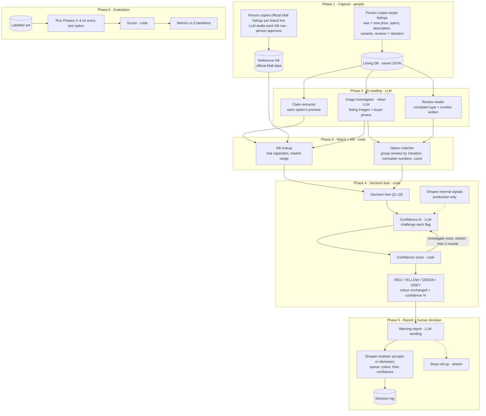
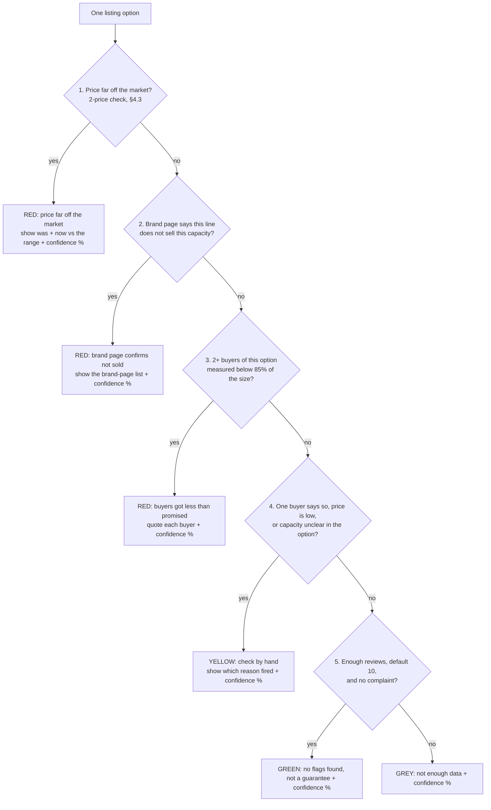
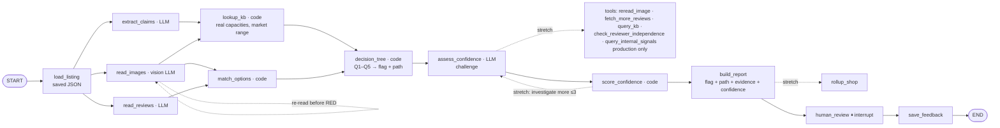

# Codex context: Sea × OpenAI Codex Hackathon Thailand · team project "ตรงปก Queue"

For the repo root as `AGENTS.md`. Prepared 20 Nov 2026 for build day, Saturday 21 Nov 2026, and checked by six independent reviewers.
The design is agreed. Values marked **default** are confirmed by the team in 5 minutes at 10:00 (§0.2) and then frozen.

---

## 0. How to work with this file (read first, Codex)

### 0.1 Rules
- **Read this whole file before your first task.** It replaces the team's discussions; do not ask the team to re-explain the project.
- **Today is build-only.** Do not re-open the design in §4. If something blocks the build, say so in one line and propose the smallest fix.
- **Be short.** No essays, no re-planning, no option lists unless asked.
- **Prefer the simplest thing that works end to end.** A complete narrow path beats a half-built big one. Follow the milestones in §6 and the cut order in §7.
- **Never invent data.** Listings, reviews and prices are copied by people on the day. Example values here show formats only.
- **Never write "fake" or "fraud" in product output.** Flags are a review priority, not an accusation.
- **Nothing was coded before the event** (our selection email: ideas only, no entry code or datasets). Only work done today is judged.
- **UI work:** read `docs/ui-standard/01-agreement.md` and `docs/ui-standard/04-pre-show-gate.md` before UI work, if present.
  The UI pack is reference, not scope: §7 (cut order) and §6 (milestones) override it. For today's Streamlit queue, apply only the `[MUST]` items in `04-pre-show-gate.md`.
- Code, comments and identifiers in English. UI text may be Thai or English.

### 0.2 Decisions the team confirms at 10:00 (then frozen)
| Item | Default | Used in |
|---|---|---|
| Product scope | USB flash drives first (the hero case); SSDs (the board's scope) only if time remains; SD/microSD out | Capture, KB |
| Review minimum for GREEN | **10** matched text reviews (team range 10–20+) | Q5 |
| Gap case | Keep: "now" below half the range's low end → RED | Q1 |
| Sale price below the range but not below half | YELLOW "price is low" | Q4 |
| Market range | Lowest to highest ฿ per GB among **3 or more** official Mall offers of the same type and capacity, using their "now" price, read today | Q1, Q4 |
| Confidence weights | §4.5 table | Confidence |
| Stack | §6 | All |
| Owners | One each: capture + KB · LLM readers · rules + queue UI · evaluation + pitch | — |
| Hand-in format, demo length | Ask the organisers at 09:00; write the answer in `README.md` | Demo |
| Rule edge cases (issue #1) | **Decided by the lead: 1A, 2A, 3A** (eval split by deciding question · deciding reason Q3 > Q2 > Q1 · 2-price second clause below 0.75 × `L`). Already written into this file | §4.2, §4.3, §4.5, §5 |

### 0.3 Working agreement for every task (team rules, partly from OpenAI's GPT-6.2 guidance)
1. **Make reasonable, reversible assumptions and keep going.** State each assumption in one line. Stop and ask only for a scope change, a real blocker, a decision only the team can make, or anything destructive (deleting data, force-pushing, rewriting history).
2. **Before saying "done", report what you checked and how** (tests run, the command, what you looked at), **and list anything you could not run or check, with the reason** (missing file, tool failed, no access). Never hide a blocker.
3. **Use subagents for independent parts** of a task, then compare their results in one summary.
4. **Prefer the existing code.** Reuse what is there, keep diffs small, check who calls a function before changing it, name variables so a teammate understands them.
5. **Add a test when the existing tests would not catch the bug you fixed.** The acceptance cases in §4.11 must keep passing.
6. **Write summaries for a teammate who did not see the work:** what changed, what to check, what is still open. Short.
7. **Secrets:** the API key lives in `./.env` as `OPENAI_API_KEY=...`. Confirm `.env` is in `.gitignore` before the first commit. Never print, log or commit keys.
8. **Codex log (judges score "effective use of Codex"):** for every task that changes code, tests, data or prompts (skip questions and reading), add one row to `docs/codex-log/<git user.name>.md` (create it from the template in `docs/codex-log/README.md` if missing): time (from `date`) · person · task · model/effort · result · how it was checked. Put the row in the same commit as the change and mention it in your "done" report. One file per person avoids merge conflicts between teammates.

---

## 1. The hackathon (what affects the build)

Source: official event page https://luma.com/39zve8ph (read 20 Nov 2026) and the organisers' emails. Venue and check-in details are in `docs/team-codex-tips.md`.

| Time | What |
|---|---|
| **10:00** | **Hacking begins** |
| 12:30 | Working lunch |
| **17:00** | **Code freeze and submissions** |
| 17:15 | Round 1 judging: judges rotate to teams; Thai or English, judged equally |
| 19:30 | Finalist presentations (English preferred, Thai accepted; language does not affect score) |
| 20:30 | Awards · 21:00 end |

**Build directions** (from the official page). A project may tackle one or span several; "the problem is yours to define".
1. **Autonomous & Adaptive AI:** Build agents that can be trusted to operate without constant human oversight - handling the unexpected and staying reliable when real-world conditions change.
2. **AI-Native Products & Operations:** Many products today use AI as an add-on. This direction is about what products and operations look like when AI shapes them more fundamentally.
3. **Deep Domain AI:** Build AI that goes deep in a specific field - reflecting how work is actually done, not a simplified version of it. The value comes from genuine domain understanding, not general capability.

**Our direction:** Deep Domain AI (storage-fraud domain rules), with AI-Native Operations (an AI-shaped review queue).

**Judging criteria (verbatim):** "Problem framing, build quality, depth of thinking, and effective use of Codex."

**Resources:** each member has USD 100 Codex credits and USD 100 OpenAI API credits; the crew can add more on the day.

---

## 2. What matters for winning

1. **Answer the four criteria:**
   - *Problem framing:* a Shopee reviewer cannot read thousands of reviews per listing; capacity fraud on storage is common, measurable and option-specific.
   - *Build quality:* one complete path from a copied listing to a reviewer decision, working live.
   - *Depth of thinking:* domain rules (GB vs GiB, fake drives reporting a fake size, per-option reviews, the 2-price check) and an honest evaluation against simple baselines.
   - *Effective use of Codex:* show `docs/codex-log/` and one real Codex transcript. Codex does not have to run inside the product.
2. **Beat the baselines with numbers:** 1–2-star sort, Shopee's complaint tag, one ChatGPT prompt. Report wins, ties and losses with the sample size, honestly.
3. **Narrow and complete beats big and broken.**
4. **Full autonomy is not required.** The AI does many small, checkable decisions; a person makes the final call.
5. **Evidence, not guesses:** every flag shows the quotes, numbers and sources behind it.
6. **Do not claim "nobody does this".** Shopee may have internal checks we cannot see.
7. **Data access:** Shopee pages resist bots, so people copy listings by hand. Do not build a scraper.

**One-sentence pitch:** "For every option of a storage listing, we turn buyers' own measured numbers into one review-priority colour with the quotes, the rule path and a confidence score, so a reviewer sees in seconds what stars and price hide."

**Judges will ask (have answers ready):** Which direction, and why? How do you know a review is about that option? Is a genuine 64 GB card showing 58 GB flagged? What are your false alarms and sample size? Did you tune 85% after seeing the results? Show one Codex transcript.

---

## 3. The problem and the product

**Problem.** On Shopee, a storage listing often has several options (64 GB, 128 GB, 1 TB…). Some options deliver far less than promised. Buyers say so in reviews ("only 29 GB"), but the evidence is spread across many reviews and mixed between options. Stars and price often look normal.

**Product: "ตรงปก Queue".** For each option of a listing, compare what the option promises with what buyers of that exact option report, and give a Shopee reviewer **one colour per option** with the evidence.

| Colour | Meaning |
|---|---|
| RED | Review first |
| YELLOW | Check by hand |
| GREEN | No flags found (not a guarantee) |
| GREY | Not enough data (never shown as green) |

**User:** a Shopee listing reviewer (platform staff). **Output:** a queue sorted by colour, then confidence, with an evidence card per option.

**Domain facts the code must respect**
- **GB vs GiB:** shops sell in decimal GB (10⁹ bytes); computers often show binary GiB (2³⁰ bytes). A genuine 64 GB card shows about 57–59 "GB" (59.6 GiB before formatting). A genuine 2 TB drive shows about 1.81 "TB". Normal, not a shortfall.
- **Fake drives report a fake size to the computer.** A Properties window showing the full size proves nothing. Only a completed write-and-verify test (H2testw on Windows, F3 on Linux/macOS) shows the real size.
- **Reviews carry a "Variation" field** naming the option bought. Only reviews of the same option count for that option.
- **Few ratings have text:** the team's earlier sample suggested about 1 in 7. Measure it on today's listings before quoting it.
- **Suspicious listings often show huge discounts** (−90% or more). The crossed-out "was" price is set by the seller.

---

## 4. The design (the board's "Adjusted ver.": the 3rd version, sharpened)

The team whiteboard's adjusted version is the design to build. Red circles on the board mark what changed from the 3rd version.

### 4.1 System flow (6 phases)



### 4.2 Decision tree (code, not LLM; evaluated per option)



**Exact rules.** The first rule that fires sets the colour; every other triggered reason is still listed on the card. All values are per option, keyed by `(listing_id, option_id)`.

**Deciding reason.** Evaluate Q1, Q2 and Q3 every time. When more than one RED rule fires, the colour is still RED and the **deciding reason** is the strongest one: **Q3 (buyers) > Q2 (brand page) > Q1 (price)**. The path, the confidence factors (§4.5) and the evaluation split (§5) use the deciding reason; the other reasons stay listed on the card. For YELLOW, GREEN and GREY the deciding reason is the rule that set the colour.

Before the tree:
- `promise_gb`: capacity from the option label (1 TB = 1,000 GB). Missing, unclear or conflicting with the title → `capacity_unclear = true`.
- `kb`: the KB row whose brand (or alias), product line and type match exactly; otherwise none.
- `L`, `H`: the market range for this type and capacity in ฿ per GB × `promise_gb` = the normal total price range in THB. None if `kb` or the range is missing.
- Matched reviews: only reviews whose Variation equals this option. Unmatched or ambiguous reviews never count.
- Measured shortfall: §4.4. Each buyer counts once.

| Step | Fires when | Result |
|---|---|---|
| Q1 | `L` exists and (`now < L/2`, or `was` exists and `now < 0.75 × L` and `was` is outside [`L`, `H`]) | RED |
| Q2 | the dated brand-page capacity list for the exact line excludes `promise_gb` | RED |
| Q2 (Mall only) | the size is absent from the Mall-observed capacities but no brand-page list exists | add a YELLOW reason; continue to Q3 |
| Q3 | 2 or more separate buyers each report a measured shortfall | RED |
| Q4 | any of: exactly 1 measured shortfall; a capacity complaint with no usable number; `L` exists and `L/2 ≤ now < L` (price is low); `capacity_unclear`; the Mall-only reason | YELLOW |
| Q5 | matched text reviews ≥ 10 (default) and zero capacity complaints | GREEN |
| else | — | GREY |

- Brand or line not in the KB: Q1, Q2 and the Q4 price reason are skipped (no guessing); the tree continues at Q3.
- An overpriced listing (both prices above `H`) gets no price flag.
- **Colour = review priority. The delivered-mismatch verdict belongs to the human reviewer.** The card shows verdict "unsure" until a person accepts or dismisses the flag. "Minimum evidence volume" means Q3's 2+ separate measured buyers.

**Evidence shown per outcome:** Q1 the two prices and the range with its sources and date · Q2 the brand-page excerpt, URL and date · Q3/Q4 the exact buyer quotes, numbers and dates · GREEN the count of matched reviews checked · GREY what is missing and the counts. Always: the tree path, image references, and what would change the result.

### 4.3 The 2-price check (Q1), explained

Each listing shows the crossed-out **"was"** price and the **"now"** price paid. A genuine shop has **"was" OR "now" inside the normal market range**:
- Honest sale: "was" is the real market price; "now" is lower.
- Inflated discount: "was" is set high; "now" is the real market price. A fake *discount*, not a fake *product*.

Example: a 1 TB option; market range ฿1.8–2.4 per GB → `L` = ฿1,800, `H` = ฿2,400 for 1,000 GB.

| Case | was | now | Result |
|---|---|---|---|
| Real sale | ฿2,000 ✓ | ฿1,500 | Q1 does not fire; Q4 "price is low" → YELLOW |
| Inflated discount | ฿6,000 | ฿2,000 ✓ | No price flag |
| Fake product | ฿2,990 | ฿299 | both outside, now below range → RED |
| Gap case | ฿2,000 ✓ | ฿299 | now below half of `L` (฿900) → RED |
| Overpriced | ฿3,500 | ฿3,000 | both above → no price flag |
| Reseller undercut | ฿2,990 | ฿1,500 | `was` outside, but `now` ≥ 0.75 × `L` (฿1,350) → Q1 does not fire; Q4 "price is low" → YELLOW |

- Use the option's price before personal coupons, coins and shipping.
- Compare at the same type and capacity: per-GB prices usually differ between sizes.
- "Price RED" means review first, not proof. A person decides.
- Why 0.75 × `L` in the second clause: `L` is the **lowest** Mall "now" price, so a reseller slightly under Mall with an inflated "was" is common and should not be RED. It gets YELLOW "price is low" instead (decided in issue #1, option 3A).

### 4.4 Reading buyers' numbers (Q3, Q4)

- The reader extracts, per review: quantity, unit, **role** (delivered capacity · fails after · OS-reported · test result · promise · free space · speed · other) and the exact quote.
- Only **delivered capacity**, **fails after** ("files corrupt after 30 GB") and **completed test results** can be a measured shortfall. Free space, speed and the promise never count.
- A bare number inherits the option's unit. Thai digits are parsed. Explicit GiB/TiB are kept as binary.
- For GB/TB without a binary label, read the number both ways and take the larger: GB → ×10⁹ or ×2³⁰ bytes; TB → ×10¹² or ×2⁴⁰ bytes. Compare with `promise_gb` × 10⁹ bytes.
- **Measured shortfall = strictly below 85%.** Exactly 85% does not count.
- Unresolved unit or conflicting numbers in one review → abstain: it becomes a complaint with no usable number (Q4).
- Each buyer counts once across their text and images. Separate buyers = different masked buyer names; identical review text under two names counts once until a person checks.

Checks: 64 GB, "58" → 58 × 2³⁰ = 62.3 × 10⁹ = 97% → not a shortfall · "29" → 48.7% → shortfall · "30.5" → 51.2% → shortfall · "files corrupt after 30 GB" → 50.3% → shortfall · 2 TB, "1.81 TB" → as TiB 99.5% → not a shortfall.

### 4.5 Confidence (runs after the colour; never changes it)

Board design (6 steps): (1) base score in code from the evidence; (2) LLM challenge: what could be wrong? (GB vs GiB, wrong option, flash sale, duplicate buyer); (3) investigate with tools: re-read an image, permitted captured reviews, KB, reviewer independence; (4) code adjusts the score within ±20 of the base, with a written reason per change; (5) stop when the change is under 5 points, after 3 rounds, or when no tool adds evidence; (6) output confidence %, reasons, missing evidence, evidence references.

**Build v1:** steps 1, 2 and 6 with one challenge round and no tools; steps 3–5 are stretch.

**Default weights:**
| Factor | Points |
|---|---|
| Start | 50 |
| 2 or more separate buyers support the deciding reason | +15 |
| The deciding evidence quotes a clear number | +10 |
| Every deciding review matches the option exactly | +10 |
| KB row and market range read today from 3+ offers | +10 |
| A completed H2testw/F3 result supports the flag | +10 |
| An option match is uncertain | −10 |
| The image evidence is OS-screen only | −10 |
| The range is thin (under 3 offers) or the KB row is missing | −10 |

- Clamp to 0–100. Apply each factor once. The review count is **not** a factor (team decision).
- LLM challenge: code accepts a challenge only if its quote or source exists; each accepted challenge moves the score by 5 or 10 with a reason; the total stays within ±20 of the base.
- **Queue order:** RED, YELLOW, GREY, GREEN. Within RED, YELLOW and GREY: confidence high to low. Within GREEN: **low to high**, so people check low-confidence GREENs (team decision: the AI never moves GREEN to YELLOW). Ties: `listing_id`, then `option_id`.

### 4.6 Images (supporting evidence)

- Classify each image first: OS Properties (reported capacity only), completed H2testw/F3 result (measured), speed test, packaging/model code, other. The reader may answer "cannot read".
- A completed H2testw/F3 result supplies that buyer's measured number. An OS Properties number only supports that buyer's text; alone it is not measured.
- **Before an image-dependent RED, re-read the original image once.** If still unresolved, drop that reading and re-run the tree. Then freeze the colour.
- One screenshot alone never gives RED (Q3 needs 2+ buyers). Keep every original image.
- Listing images: printed capacity, model code and packaging, compared with the KB's reference images (stretch).

### 4.7 Source-of-truth KB

| Field | What it holds | Example format (not real data) | Used in |
|---|---|---|---|
| Brand | Maker name, Thai + English | Samsung / ซัมซุง | Match |
| Aliases | How sellers write the name | SanDisk, ซานดิสก์ | Match |
| Product line | Official line name | As written on the official page | Match |
| Type | USB flash drive, SSD internal, SSD portable | USB flash drive | Scope |
| Real capacities (Mall) | Capacities seen across the official Mall listings | 64 / 128 / 256 | Q2 Mall-only reason |
| Brand page | Manufacturer page URL, date read, capacity list | URL · date · 64/128/256 | Q2 RED |
| Market range | Lowest–highest ฿/GB per type + capacity, offers used, date | 64 GB: 3.0–4.5 ฿/GB, 3 offers, 21 Nov | Q1, Q4 |
| Mall sources | Each official listing used: URL, date, capacity, "now" price | URL · date · 64 · ฿249 | Evidence |
| Expected display | What a computer shows per size | 64 GB: about 57–59 GB | Card text |
| Reference images | Official product, packaging, model-code format | Link + date | Images (stretch) |
| Interface + speed, warranty | Official values | USB 3.2 · 5 years | Stretch |

- The LLM drafts each row from the official listings; **a person approves each row**.
- Empty or missing means "not in the KB": skip the rules that need it; never guess.

### 4.8 LangGraph: storage flags checker (Phases 2–5)



- A SQLite checkpointer saves state after every node; a saved reviewer decision survives a restart. Phase 1 (capture) and Phase 6 (evaluation) are outside the graph.
- Build every node first as a plain Python function over the shared state, run end to end as a script, then wire them into LangGraph (§6).

### 4.9 Safeguards (apply to every colour)

- RED / YELLOW / GREEN / GREY are review-priority flags. Price RED means "review first", not proof.
- The delivered-mismatch verdict stays "unsure" until a person decides; no automatic penalty.
- Positive reviews never cancel credible negative evidence.
- Keep evidence references and original images. Use masked buyer names only.

### 4.10 Data shapes (field names; keep them stable)

```text
listing:  listing_id, url, captured_at, title, spec_text, description, listing_images[], options[], reviews[]
option:   option_id, variation_label, capacity_text, promise_gb | null, was_thb | null, now_thb
review:   review_id, variation_label, option_id | null (matched by code), buyer_masked, date, stars,
          text, tags[] (Shopee complaint tags if shown), images[]
kb_row:   brand, aliases[], product_line, type, mall_capacities_gb[], brand_page {url, date, capacities_gb[]} | null,
          market_range[] {capacity_gb, low_thb_per_gb, high_thb_per_gb, offers_used, date},
          mall_sources[] {url, date, capacity_gb, now_thb}, expected_display, approved_by
finding:  review_id, option_id, complaint (capacity_short | capacity_no_number | wrong_item | other | none),
          quantity | null, unit (MB | GB | TB | GiB | TiB | none), role, bytes | null, ratio | null,
          quote, image_ref | null, image_type | null, read_status (ok | cannot_read)
flag:     listing_id, option_id, colour, deciding (Q1 | Q2 | Q3 | Q4 | Q5 | grey), path[], reasons[], evidence[],
          verdict ("unsure" | "mismatch" | "no_mismatch"),
          confidence {score, base, adjustments[] {points, reason}, missing_evidence[], rounds},
          reviewer_decision {decision: accepted | dismissed, reason, at} | null
```

### 4.11 Acceptance cases (write these as tests first)

1. 64 GB option, 4 separate buyers wrote "only 29 GB" / "30.5 GB" → RED (Q3), the 4 quotes shown.
2. 64 GB option, a buyer wrote "58" → not a shortfall; with 10+ clean matched reviews → GREEN.
3. 1 TB option, range ฿1,800–2,400: was 2,990 / now 299 → RED · was 6,000 / now 2,000 → no price flag · was 2,000 / now 1,500 → YELLOW "price is low" · was 2,000 / now 299 → RED · was 3,500 / now 3,000 → no price flag.
4. Two reviews with identical text under different masked names → counted once.
5. A review whose Variation is another option → never counted for this option.
6. Brand not in the KB → Q1, Q2 and the price reason skipped; colour comes from Q3–Q5.
7. "files corrupt after 30 GB" on 64 GB → measured shortfall.
8. 2 TB option, "1.81 TB" → not a shortfall.
9. A number exactly at 85% → not a shortfall.
10. Accept a flag, restart the app → the decision is still saved.
11. 1 TB option, range ฿1,800–2,400: was 2,990 / now 1,500 → no Q1 RED (now ≥ ฿1,350); Q4 "price is low" → YELLOW. Was 2,990 / now 1,200 → RED.
12. An option where Q1 (price) and Q3 (4 separate measured buyers) both fire → RED, deciding reason Q3, the "+15: 2 or more separate buyers" factor applies, and the price reason is still listed.

---

## 5. Evaluation and demo

**Evaluation (Phase 6)**
- Freeze all thresholds, prompts and baseline cut-offs **before** the evaluation run.
- A teammate who did not write the rules labels each test option blind: "buyers report a real shortfall: yes / no".
- **Split by deciding reason (issue #1, option 1A).** The blind label asks about buyers, so only REDs whose deciding reason is **Q3** are scored against it as the tool's positive (also report Q3 RED + YELLOW). REDs decided by **Q1 (price)** or **Q2 (brand page)** are reported as separate counts with the label each option got, and are never counted as false alarms of the buyer check.
- Baselines on the same options: share of 1–2-star reviews (cut-off fixed in advance) · Shopee complaint tag present · one ChatGPT prompt given the same copied listing.
- Report true positives, misses and false alarms **with the sample size**, wins/ties/losses per option, confidence against correctness by score band, and photo-reading accuracy against a person's reading. Do not claim accuracy beyond the sample.

**Demo hero case:** a 64 GB flash drive where 4 buyers wrote "only 29 GB / 30.5 GB": RED with the 4 quotes, while price and stars look normal (4.8 stars, 30k+ sold), so a price or star check would miss it. Show it next to a genuine card where "58 GB" stays quiet. Capture this case first; backup: a 1-buyer YELLOW. (The example shows review priority; the mismatch verdict is the reviewer's.)

**Second moment:** the 2-price check on a "was ฿2,990, now ฿299" listing (RED) next to an inflated-discount listing that correctly gets no price flag.

---

## 6. Build defaults

**Stack (default):** Python 3.12 via `uv`; nodes as plain functions over one shared state dict, run end to end as a script first, then wired into LangGraph with a SQLite checkpointer; Streamlit for the reviewer queue (fallback: a printed table); OpenAI Responses API with `gpt-6.2-sol` for the readers. No LLM tool calling in v1: code does all retrieval.

**Capture caps:** KB only for the product lines in the target listings: one brand and 2–3 lines first, 3 official Mall offers per type + capacity. 4–6 target listings; per option up to 30 text reviews, newest first. Keep original text, images, dates, stars, tags and masked buyer names.

**Milestones:** 10:00 confirm §0.2 (5 minutes), write the data shapes and the §4.11 tests · 11:30 capture done · 14:30 end-to-end path works · 15:30 evaluation done · 16:00 demo rehearsal · 17:00 code freeze.

**LLM API notes** (OpenAI developer docs, read 20 Nov 2026)
- Model IDs: `gpt-6.2-sol` (everyday work) and `gpt-6.2-astra` (hardest tasks). Per 1M tokens in/out: Sol $2/$10, Astra $8/$40.
- Tool calling with these models requires the Responses API ("support Chat Completions, but tool calling requires Responses").
- Start `reasoning.effort` at `medium`; do not send `temperature` or `top_p`.
- Put reusable instructions in a developer message at the start of the input (prompt caching); do not edit earlier turns.
- The model may fail to report a blocker (a missing file, a broken tool). Code checks every LLM output: quotes must exist in the copied text, numbers must parse, JSON must validate.
- Cost control: cache reader outputs by `(review_id, prompt_version)`; if one call per review is slow, batch the reviews of one option into one structured call; one confidence round in v1.
- API credits: each member has USD 100; one member's key goes in `./.env`.

## 7. If time runs short

**Cut in this order:** (1) shop roll-up; (2) interface, speed and warranty checks; (3) confidence tools and extra rounds; (4) listing-image checks; (5) LangGraph wiring (keep the plain script).
**Never cut:** option matching, the 85% rule, the 2-price check, evidence on every flag, the person's decision, the evaluation against baselines.

**Fallback at 15:00 with no end-to-end path:** run the tree and the 2-price check on the saved JSON listings as one script, show colours and quotes in the queue, drop confidence and evaluation, and say "narrow path, evaluation next". If the LLM is down, show cached reader outputs.

## 8. Board labels that differ from §4 (use §4)

- The system diagram's KB lookup says "price band, price per GB": use the market range (§4.3).
- The system diagram's claim extractor says "price": capture both "was" and "now".
- The board's 2-price box says the real sale is "OK": it passes Q1, and Q4 then gives YELLOW "price is low".
- The board's scope says "SSD + flash drives": today's default starts with USB flash drives (§0.2).

## 9. Glossary

| Term | Meaning |
|---|---|
| Option / Variation | One variant of a listing (e.g. 64 GB); reviews name it in a "Variation" field |
| Promise | The capacity the option claims |
| Measured shortfall | A buyer's delivered-capacity number strictly below 85% of the promise after the GB/GiB reading |
| Market range | Lowest–highest normal ฿/GB for the same type and capacity from 3+ official Mall offers, dated |
| `L`, `H` | The market range × the option's GB = normal total price range in THB |
| "was" / "now" | The crossed-out price / the price paid |
| KB | The source-of-truth table of brands, lines, capacities and market ranges |
| Mall | Shopee's official brand stores |
| H2testw / F3 | Write-and-verify tools that reveal a drive's real capacity |
| Deciding reason | The rule shown as the reason for the colour; for RED the strongest that fired (Q3 > Q2 > Q1) |
