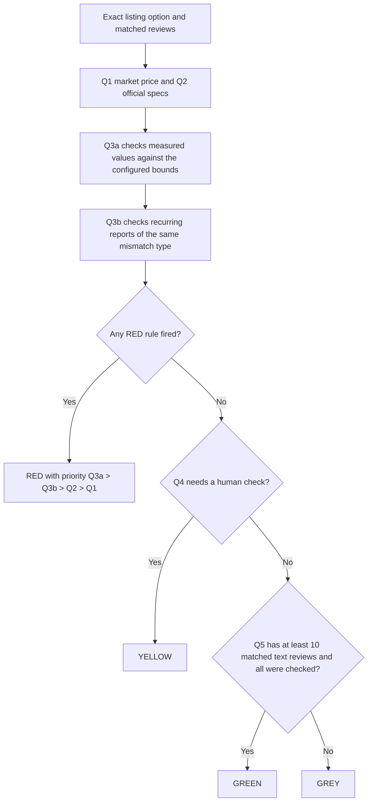

# Worldwide category profiles and automatic pipeline

A profile defines the promised attribute, its units or mismatch types, its evidence rules and its locale. Deterministic rules set each option's review priority. A person records the verdict after reviewing the evidence.

## Decision tree



- **Q3a** requires exact-Variation evidence from at least two independent masked buyers, each with a usable measured value outside the profile's bounds. The legacy deciding label is `Q3`. Storage keeps its existing result shape for byte-identical replay.
- **Q3b** requires exact quotes from at least two independent masked buyers reporting the same configured mismatch type. Divide the independent reports for that type by the total exact-matched nonblank text reviews. The rate must be strictly above `baseline_mismatch_rate`. Repeated buyer names and identical review texts cannot inflate the numerator. The test runs separately for each type.
- **Q4** keeps credible reports in view, including one measurement outside tolerance, one categorical report, recurring reports at or below baseline, and complaints without a usable number. Checking clean reviews can affect the rate and GREEN eligibility. Credible negative reports stay visible.
- **Q5** requires at least 10 exact-matched text reviews, all checked, with no preceding rule firing. GREY covers insufficient evidence. A pipeline job with an AI failure is marked **not checked** and cannot return GREEN.

Storage keeps its existing price and official-spec RED rules for the frozen replay, including the price-only RED for listing `50570965257`. Each RED under the new categories requires two independent buyers.

Review text is untrusted input. The reader extracts structured evidence and the code verifies its quotes against the captured text. Flags keep masked buyer names and neutral wording. The queue marks any omitted words in a quote and retains its review ID. The AI may challenge confidence with a cited source, within 20 points of the base score. The colour and human verdict remain outside the AI's control.

## Add a category

1. Create `profiles/<category>.json` with a matching category ID and a version. Use `clothing.json` for categorical evidence or `cable_length.json` for measured evidence. Record currency, price-per-unit basis where applicable, locale, languages, localized unit aliases and prompt traps, and marketplace field names. The analyzer and pipeline map those fields into the standard capture shape, as shown in the clothing sample.
2. Set the measured roles and numeric bounds, or list the categorical mismatch types and their baseline. Use `mismatch_cues` for localized statements that support a categorical report and `completed_measurement_cues` when a test needs explicit evidence of completion. For measurements, define unit factors on one common basis and state the test conditions that make values comparable. The cable profile treats measurements below 95% or above 105% of the advertised length as outside tolerance. The battery sample uses a 2,000 mAh typical promise and a 95% lower bound, which gives the stated 1,900 mAh minimum. A person reviews the minimum-to-typical ratio and discharge conditions for the cell specification covered by the profile.
3. Add labelled synthetic **Sample data** for expected normal and mismatch cases. Use the exact Variation and quotes in the saved findings. Numeric options supply `promise_value` in the profile's promised unit and `measurement_text`. Measured quotes for new categories include an explicit supported unit or alias.
4. Have a person verify the official evidence, units, test conditions, thresholds, and interpretation for each locale. Give profile changes a new version. The tool rejects a profile marked `pending human review` by default. `--allow-draft` explicitly opts into a draft for a trial and leaves its approval status intact.

To ask the Responses API to draft from official specifications, set `OFFICIAL_SPEC_URL` to a public HTTPS manufacturer page and run the following from the repository root. You can pass more official URLs after the first.

```sh
uv run --locked python profiles/draft.py new_category "$OFFICIAL_SPEC_URL"
```

The command saves `profiles/new_category.json` as `pending human review` and preserves an existing profile at that path. Hosted search filters to the supplied domains. The command saves the validated draft only when the API reports completed opens of the exact supplied URLs and retrieves no other pages. A person still verifies source ownership, relevance and the proposed thresholds.

## Run the samples

All three sets below are **Sample data**. These commands use saved findings and write flags to separate scratch directories.

```sh
for category in clothing cable_length aa_rechargeable_battery; do
  sample="tests/fixtures/worldwide/$category"
  uv run --locked trongpok-analyze \
    --profile "$category" --allow-draft \
    --findings-dir "$sample/findings" \
    --output-dir ".worldwide-sample-flags/$category" \
    "$sample"/listings/*.json
done
```

| Profile | Sample outcome |
|---|---|
| Clothing | Two independent reports of a size mismatch above baseline produce RED Q3b |
| Cable length | Two measured lengths above the upper bound produce RED Q3 |
| AA rechargeable battery | A reading above the stated minimum and 10 checked text reviews produce GREEN Q5 |

The existing power bank samples also require `--allow-draft`. Their profile retains the 50% threshold from the branch base.

## Automatic pipeline

The following watch command checks for new and changed listing JSON files. `--message path/to/message.json` takes a single queue payload with a `listing` object. These commands use the Responses API.

```sh
uv run --locked trongpok-pipeline --watch data/listings --state-db .worldwide-pipeline.sqlite3
```

1. Load each listing and identify the option job by listing ID, option ID, evidence hash, profile version and prompt version. Replaying the same job reuses its saved result. SQLite stores job state and the latest flag for each option in the selected profile. Duplicate broker messages reuse the same snapshot. Directory scans select the newest dated capture for each listing before scheduling analysis. Explicit file replays remain available. Use the same profile and approval options with `--queue`.
2. Read the reviews with profile-aware structured output and reuse cached reads by review ID and prompt version. Keep option matching, quote validation and colour assignment in code.
3. Ask for up to three confidence rounds. Apply only valid challenges with cited evidence and keep the combined adjustment within ±20 points. The queue shows the source of each accepted adjustment and the flag's original analysis date. Stop on a change below five points or a round with no new cited source.
4. Save the flag and publish it to the reviewer queue. A per-job budget limits API use. Quota errors, exhausted budgets, invalid AI output and other AI failures put the job in **not checked**. Transient errors use bounded retries with backoff.

The queue provides review priorities. A reviewer inspects the evidence and makes the decision for each flag.

## Current limits

- The storage reference adapter is the only implementation with market data and official specifications. Other categories skip Q1 and Q2 until an adapter can supply dated references. Profile currency and locale do not establish a market range.
- The dashboard export, Streamlit review flow, legacy live reader, image handling, and evaluation still use storage contracts. The automatic pipeline processes captured listing JSON and review text.
- Draft profiles and samples are for review. They provide no validated mismatch rates, market ranges or production accuracy estimates for the new categories.
